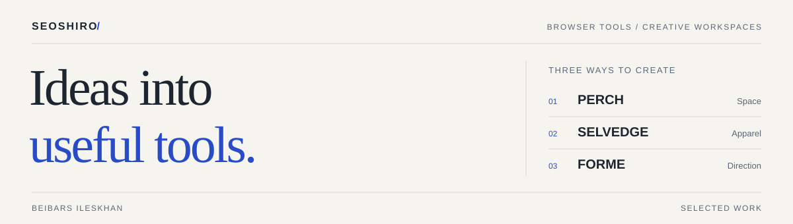
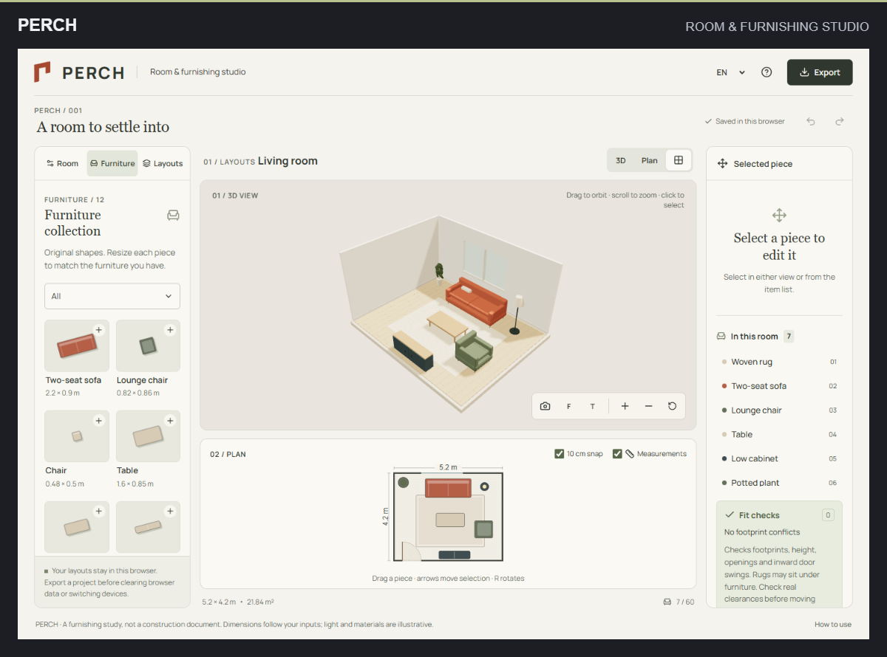
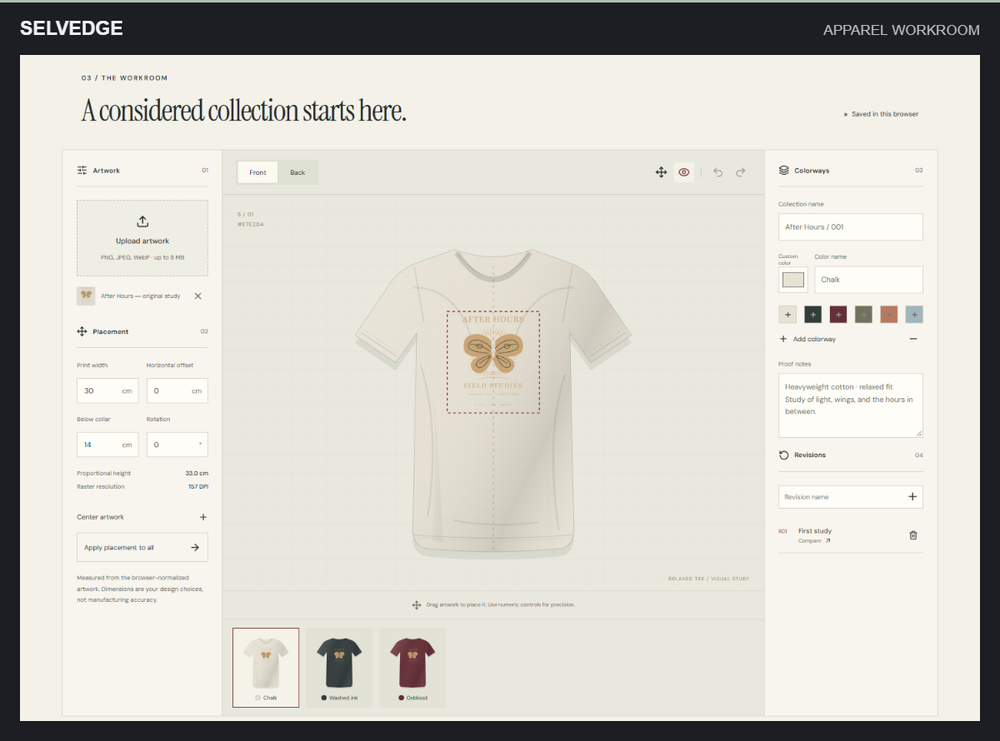
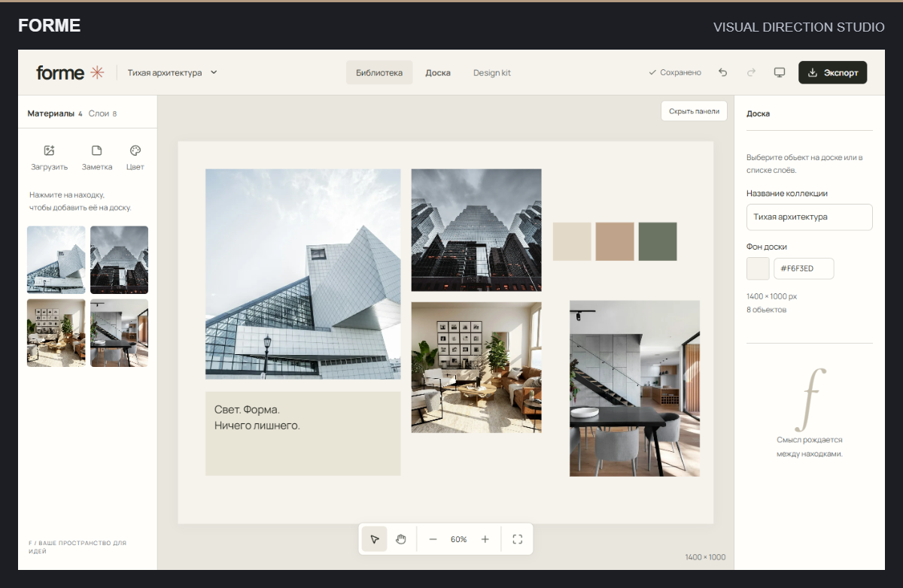

<picture>
  <source media="(prefers-color-scheme: dark)" srcset="assets/profile-dark.svg">
  <source media="(prefers-color-scheme: light)" srcset="assets/profile-light.svg">
  
</picture>

# Beibars Ileskhan

**AI-assisted product creator · seoshiro**

I turn ideas into browser tools with AI, shaping the brief, visual direction, and workflow. I’m learning programming through the projects I make.

I care about clear next steps, local data you can keep, and exports you can use elsewhere.

**[Explore the portfolio ↗](https://seoshiro.github.io/)** · [Selected work](#selected-work) · [How I create](#how-i-create) · [Repositories](https://github.com/seoshiro?tab=repositories)

## Selected work

Three creative studios: plan a space, shape a collection, find a direction.

[**01 / PERCH**](#01--perch) &nbsp; · &nbsp; [**02 / SELVEDGE**](#02--selvedge) &nbsp; · &nbsp; [**03 / FORME**](#03--forme)

### 01 / PERCH

**Room planning, in 2D and 3D.**

Set up a rectangular room, resize furniture to match what you own, and compare independent layouts before moving a single chair.

**Take away:** a dimensioned plan, a 3D image, or a printable room report.

**[Open PERCH ↗](https://seoshiro.github.io/perch-studio/)** · [Source](https://github.com/seoshiro/perch-studio) · [Case study](https://seoshiro.github.io/projects/perch.html)

Three.js · SVG · Local browser saves · EN / RU / KK

---

### 02 / SELVEDGE

**One graphic. A considered collection.**

Place artwork, explore garment colors, and compare named revisions in a browser workroom for tee collections.

**Take away:** a collection PNG, a PDF visual proof, or an editable project. The proof supports a conversation with a printer; it is not a manufacturing specification.

**[Open SELVEDGE ↗](https://seoshiro.github.io/selvedge-studio/)** · [Source](https://github.com/seoshiro/selvedge-studio) · [Case study](https://seoshiro.github.io/projects/selvedge.html)

Canvas · IndexedDB · EN / RU / KK

---

### 03 / FORME

**From scattered references to a direction.**

Collect images and notes, compose a moodboard, and turn its colors and typography into a reusable design kit.

**Take away:** PNG, CSS variables, design tokens, or a portable project with the original images.

**[Open FORME ↗](https://forme-studio-coral.vercel.app/)** · [Source](https://github.com/seoshiro/forme-studio) · [Case study](https://seoshiro.github.io/projects/forme.html)

Web Workers · IndexedDB · Russian interface

Portfolio projects, shown with demo materials in the actual apps. Each repository documents its scope and limits.

## More work

**[GuideCheck ↗](https://seoshiro.github.io/guidecheck/)** — Compare instruction revisions and keep human review evidence with the relevant steps. Portable workspace backups; EN / RU / KK. [Source](https://github.com/seoshiro/guidecheck)

**[ArchiveGuard ↗](https://seoshiro.github.io/archiveguard/)** — Review JPEG capture metadata against Google Photos sidecars and export checked copies with an audit trail. Original files stay untouched. [Source](https://github.com/seoshiro/archiveguard)

## How I create

**Define → direct → try → refine.**

I use AI for implementation and problem solving. I guide the product choices, try the workflows, and direct the next iteration.

These projects are my learning ground for TypeScript, React, browser storage, and testing. The repositories use React, TypeScript, Vite, and authored CSS, with unit tests, Playwright, and GitHub Actions documented per project.

<strong>Earlier projects</strong>

- [**AituDesk**](https://github.com/seoshiro/aitudesk) — A college IT service desk with tickets, real-time chat, a multilingual knowledge base, and reporting.
- [**AssetControl**](https://github.com/seoshiro/AssetControl) — Equipment inventory, handovers, repairs, and financial reporting.

---

**[Explore the portfolio ↗](https://seoshiro.github.io/)** &nbsp; · &nbsp; [Browse all repositories](https://github.com/seoshiro?tab=repositories)  
The portfolio is available in English, Russian, and Kazakh.
