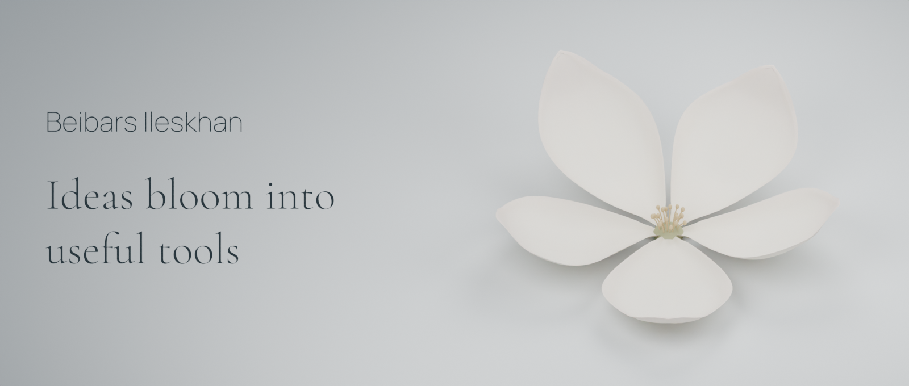
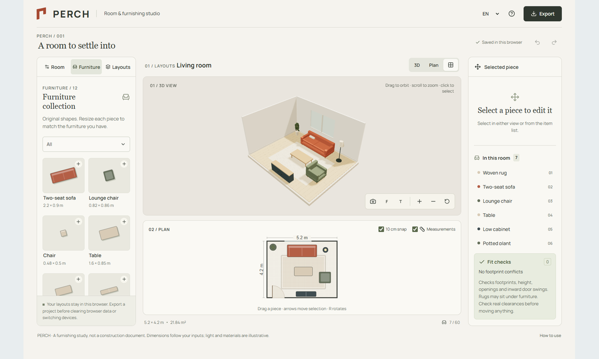
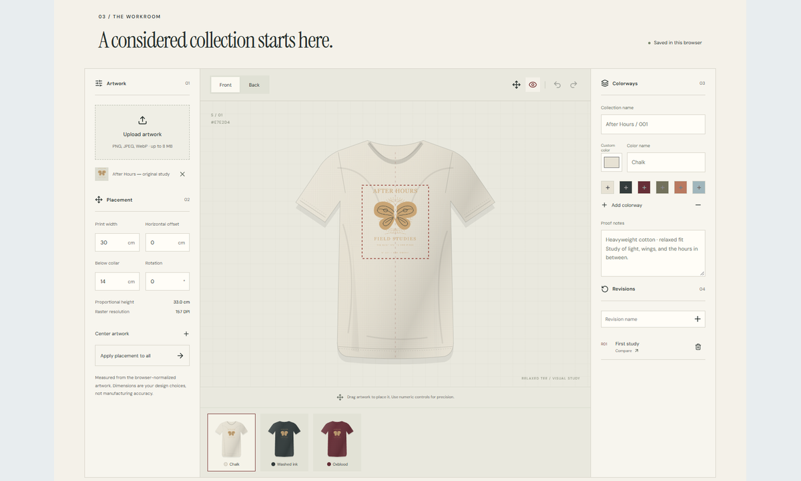
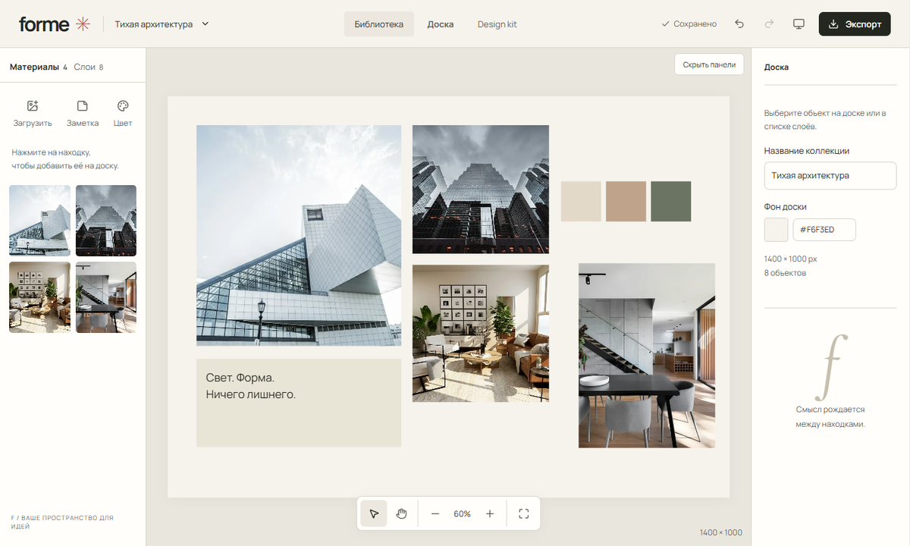
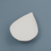

<picture>
  <source media="(prefers-color-scheme: dark)" srcset="assets/lotus-cover-dark.png">
  <source media="(prefers-color-scheme: light)" srcset="assets/lotus-cover-light.png">
  
</picture>

# <picture><source media="(prefers-reduced-motion: reduce)" srcset="assets/lotus-accent-still.png"></picture> Beibars Ileskhan

I create interactive websites and browser tools with AI. I shape the concept, visual direction, and user experience, then test and refine the result.

I’m learning programming through my projects, building my understanding of how the code works along the way.

**[Explore my portfolio ↗](https://seoshiro.github.io/)** · [Selected work](#selected-work) · [Approach](#approach) · [Contact](#contact)

## Selected work

### PERCH · Room & furnishing studio

Compare room layouts before moving furniture. One shared model connects the dimensioned plan and 3D view; independent alternatives make layouts easy to compare.

[**Demo ↗**](https://seoshiro.github.io/perch-studio/) · [Source](https://github.com/seoshiro/perch-studio) · [Case study](https://seoshiro.github.io/projects/perch.html)

### SELVEDGE · Apparel workroom

Turn one graphic into a considered tee collection. Compare named revisions and export a collection image or PDF visual proof for the next conversation with a printer.

[**Demo ↗**](https://seoshiro.github.io/selvedge-studio/) · [Source](https://github.com/seoshiro/selvedge-studio) · [Case study](https://seoshiro.github.io/projects/selvedge.html)

### FORME · Visual research studio

Give scattered references a direction. Compose an editable moodboard, then carry its colors and typography into a design kit with CSS variables and design tokens.

[**Demo ↗**](https://forme-studio-coral.vercel.app/) · [Source](https://github.com/seoshiro/forme-studio) · [Case study](https://seoshiro.github.io/projects/forme.html)

Screenshots show the real apps with demo materials. Project repositories document capabilities and practical limits.

More browser tools: [**GuideCheck**](https://github.com/seoshiro/guidecheck) for instruction revisions and human review evidence; [**ArchiveGuard**](https://github.com/seoshiro/archiveguard) for photo metadata review and verified copy exports.

## Approach <picture><source media="(prefers-reduced-motion: reduce)" srcset="assets/petal-accent-still.png"></picture>

**Define → create with AI → test → refine.**

I start with the task and the experience someone should have. I use AI to help implement it, compare the result with the brief, and guide the next revision.

## Tools behind my projects

       

React · TypeScript · JavaScript · Three.js · Vite · HTML · CSS · Git

**Project stack:** React, TypeScript, Vite, and authored CSS, with Three.js, SVG, Canvas, IndexedDB, and Web Workers where needed. These describe the projects, while I continue learning the technologies. Checks and limitations are documented in each repository.

## On GitHub

<picture>
  <source media="(prefers-color-scheme: dark)" srcset="assets/cards/activity-dark.svg">
  <source media="(prefers-color-scheme: light)" srcset="assets/cards/activity-light.svg">
  
</picture>

<picture>
  <source media="(prefers-color-scheme: dark)" srcset="assets/cards/languages-dark.svg">
  <source media="(prefers-color-scheme: light)" srcset="assets/cards/languages-light.svg">
  
</picture>

Generated from public GitHub data and stored in this repository. Language shares describe repository code, not proficiency.

## Contact

Have a website, interactive experience, or browser tool in mind?

  

[**Telegram ↗**](https://t.me/tserriednichs) · [Email](mailto:beibars.ileskhan2405@gmail.com) · [Portfolio ↗](https://seoshiro.github.io/)
