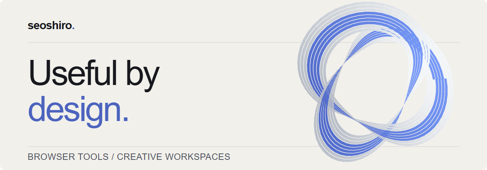

<picture>
  <source media="(prefers-color-scheme: dark)" srcset="assets/banner-dark.png">
  <source media="(prefers-color-scheme: light)" srcset="assets/banner-light.png">
  
</picture>

# Beibars Ileskhan / seoshiro

**AI-assisted product creator. Learning programming through real projects.**

I turn ideas into browser tools with AI. I shape the brief, choose the visual direction, try the workflows, and direct the next iteration. I’m learning how the code works as I go.

I care about clear next steps, local data you can keep, and exports you can use elsewhere.

**[Explore my portfolio ↗](https://seoshiro.github.io/)** · [Selected work](#selected-work) · [How I create](#how-i-create) · [All repositories](https://github.com/seoshiro?tab=repositories)

---

## Selected work

Three creative studios, each built around a practical decision:

| If you want to… | Start here | Take away |
| :--- | :--- | :--- |
| Compare room layouts | [PERCH](https://seoshiro.github.io/perch-studio/) | A dimensioned plan and room report |
| Explore a tee collection | [SELVEDGE](https://seoshiro.github.io/selvedge-studio/) | A collection image and visual proof |
| Find a visual direction | [FORME](https://forme-studio-coral.vercel.app/) | A moodboard and reusable design kit |

### 01 / PERCH — Room & furnishing studio

**Try a few layouts before moving a single chair.**

Set up a rectangular room, resize furniture to match what you own, and compare independent layouts in linked 2D and 3D views. Export a dimensioned plan, a 3D image, or a printable report.

**[Try PERCH ↗](https://seoshiro.github.io/perch-studio/)** · [Read the source](https://github.com/seoshiro/perch-studio) · [Case study](https://seoshiro.github.io/projects/perch.html)

React · TypeScript · Three.js · SVG · Local browser saves · EN / RU / KK

### 02 / SELVEDGE — Apparel workroom

**One graphic, a considered collection.**

Place artwork, explore garment colors, and compare named revisions. Export a collection PNG, a PDF visual proof, or an editable project to continue later. The proof helps a conversation with a printer; it is not a manufacturing specification.

**[Try SELVEDGE ↗](https://seoshiro.github.io/selvedge-studio/)** · [Read the source](https://github.com/seoshiro/selvedge-studio) · [Case study](https://seoshiro.github.io/projects/selvedge.html)

React · TypeScript · Canvas · IndexedDB · EN / RU / KK

### 03 / FORME — Visual research studio

**From scattered references to a direction.**

Collect images and notes, compose a moodboard, and turn its colors and typography into a design kit. Export PNG, CSS variables, design tokens, or a portable project with the original images.

**[Try FORME ↗](https://forme-studio-coral.vercel.app/)** · [Read the source](https://github.com/seoshiro/forme-studio) · [Case study](https://seoshiro.github.io/projects/forme.html)

React · TypeScript · Web Workers · IndexedDB · Russian interface

These are portfolio projects. The screenshots show the actual apps with demo materials; project repositories document their scope and limits.

---

## Tools for careful work

**[GuideCheck](https://seoshiro.github.io/guidecheck/)** — Compare instruction revisions and keep human review evidence attached to the steps it belongs to. Portable workspace backups; EN / RU / KK. [Source](https://github.com/seoshiro/guidecheck)

**[ArchiveGuard](https://seoshiro.github.io/archiveguard/)** — Compare JPEG capture metadata with Google Photos sidecars, resolve conflicts, and export checked copies with an audit trail. Original files stay untouched. [Source](https://github.com/seoshiro/archiveguard)

## How I create

**Define → direct → try → refine.**

I use AI for implementation and problem solving, while I guide the product choices and review the result. My focus is the whole experience: what someone is trying to do, how the interface helps, and what they can take away.

The projects are also my learning ground. I’m developing my understanding of TypeScript, React, browser storage, and testing by working through concrete problems with AI assistance.

**In the repositories:** React, TypeScript, Vite, and authored CSS; Three.js, SVG, Canvas, IndexedDB, and Web Workers where the project needs them. Verification includes unit tests, Playwright, and GitHub Actions, with the actual checks and gaps documented per project.

The [portfolio](https://seoshiro.github.io/) brings the work together in English, Russian, and Kazakh.

<strong>Earlier projects</strong>

[**AituDesk**](https://github.com/seoshiro/aitudesk) — A college IT service desk with tickets, real-time chat, a multilingual knowledge base, and reporting.

[**AssetControl**](https://github.com/seoshiro/AssetControl) — Equipment inventory, handovers, repairs, and financial reporting.

---

[Explore the portfolio ↗](https://seoshiro.github.io/) · [Browse the repositories](https://github.com/seoshiro?tab=repositories)
